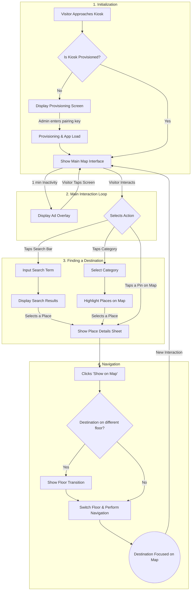
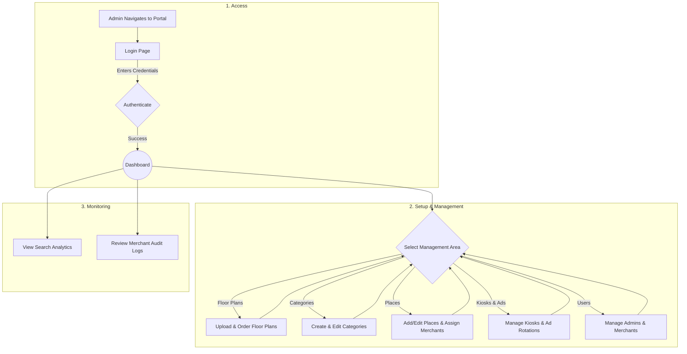

# 📍 binhinav — locate indoors

<div align="center">
  
  <p><strong>A Cohesive Digital Ecosystem for Indoor Navigation and Tenant Management</strong></p>
  <p>Engineered by <strong>binhitech</strong> — <em>Growth, Engineered.</em></p>

  <p align="center">
    
    
    
    
    
    
  </p>
</div>

---

## 🌟 Overview

**binhinav** is a complete, fully integrated indoor mapping and navigation ecosystem designed to bridge venue administrators, retail/office tenants (merchants), and physical visitors. Rather than just offering static floor guides, **binhinav** acts as a dynamic digital directory that empowers administrators to oversee venue layouts, lets tenants control their brand profiles in real-time, and guides visitors through highly responsive, interactive kiosks.

The project is developed by **binhitech**, a software firm focused on cultivating modern growth and engineering scalable, intuitive digital experiences.

---

## 📁 Repository Structure

The workspace is organized as a multi-package repository containing independent, modular components that communicate seamlessly:

```yaml
binhinav/
├── backend/            # NestJS API gateway, Database models, and Admin/Merchant controllers
├── kiosk/              # React + TS + Tailwind v4 interactive touch-screen app for visitors
├── portal/             # React + TS + Tailwind v4 administration dashboard (Admin & Merchant roles)
├── docs/               # Static documentation portal containing company, user & system manuals
└── README.md           # This primary repository overview
```

---

## 🚀 Key Modules & Features

### 🖥️ 1. The Interactive Kiosk (`/kiosk`)
The public-facing application designed for physical touch-screen devices placed strategically around a venue.
*   **Intuitive Search:** Fast, auto-suggesting search interface to find locations, offices, shops, or categories.
*   **Smart Map Navigation:** Smooth 2D map viewer with interactive touch gestures (zoom, pan, pinch) that centers, crops, and highlights routes dynamically.
*   **Multi-floor Logic:** Seamless animations and floor switches if a selected destination is on another floor.
*   **Engaging Advertisement Rotation:** Automatic full-screen promotion slideshow triggers after 60 seconds of idle time to drive traffic to tenants.
*   **One-Time Provisioning:** Secure setup wizard requiring a 6-character pairing key issued by the Admin Portal.

### 💼 2. The Admin & Merchant Portal (`/portal`)
A multi-role workspace created using Tailwind CSS v4, shadcn/ui, and Zustand for state management.
*   **For Administrators:**
    *   **Venue Control:** Upload vector/raster floor maps, define distinct categories (with custom icons), and assign interactive coordinate pins to locations.
    *   **Kiosk & Ads Manager:** Provision pairing keys for kiosk hardware and drag-and-drop promotional banners/videos.
    *   **Insights Dashboard:** Search analytics charts (using Recharts) to trace search trends, and audit logs tracking merchant updates.
*   **For Merchants (Tenants):**
    *   **Storefront Autonomy:** Direct access to update descriptions, contact details, business hours, and upload circular logos and wide cover photos.
    *   **Real-time Synchronization:** Changes immediately sync down to the backend database and update on physical kiosks instantly.

### 🛡️ 3. The Enterprise Backend (`/backend`)
A production-ready NestJS REST API, fortified with security guards and structured patterns.
*   **Database ORM:** Managed using TypeORM connecting to PostgreSQL.
*   **Rate Limiting & Security:** Throttler guards protecting endpoints, bcrypt password hashing, and Passport-JWT authorization.
*   **State Logs & Events:** Built-in `EventEmitter` driving search tracking and merchant audit tracking.
*   **Static Asset CDN:** Built-in static server serving uploads (floor plans, logos, cover photos) efficiently.

---

## 📊 System Workflows

The Binhinav ecosystem integrates three primary pipelines:

### Kiosk Visitor Flow


### Portal Administration Flow


---

## 🛠️ Local Installation & Development

### Prerequisites
*   [Node.js](https://nodejs.org/) (v18+ recommended)
*   [npm](https://www.npmjs.com/)
*   [PostgreSQL](https://www.postgresql.org/) database

### 1. Database Setup
Create a new PostgreSQL database instance for the application:
```sql
CREATE DATABASE binhinav_db;
```

### 2. Backend Server Configuration
1. Navigate to the `backend` directory:
   ```bash
   cd backend
   ```
2. Install dependencies:
   ```bash
   npm install
   ```
3. Create a `.env` file in the `backend/` root directory and set your credentials:
   ```env
   DB_HOST=localhost
   DB_PORT=5432
   DB_USERNAME=your_postgres_username
   DB_PASSWORD=your_postgres_password
   DB_DATABASE=binhinav_db
   ```
4. Start the server in hot-reload development mode (auto-schema sync will run on first connection):
   ```bash
   npm run start:dev
   ```
   The backend API will run on `http://localhost:3000/api`.

### 3. Portal Setup (Admin & Merchant)
1. Navigate to the `portal` directory:
   ```bash
   cd ../portal
   ```
2. Install dependencies:
   ```bash
   npm install
   ```
3. Create a `.env` file in the `portal/` root directory and point to the API:
   ```env
   VITE_API_URL=http://localhost:3000/api
   ```
4. Spin up the Vite development server:
   ```bash
   npm run dev
   ```
   Open the logged terminal port (typically `http://localhost:5173`) in your browser.

### 4. Kiosk Setup
1. Navigate to the `kiosk` directory:
   ```bash
   cd ../kiosk
   ```
2. Install dependencies:
   ```bash
   npm install
   ```
3. Create a `.env` file in the `kiosk/` root directory:
   ```env
   VITE_API_URL=http://localhost:3000/api
   ```
4. Spin up the Kiosk development server:
   ```bash
   npm run dev
   ```
   Open the logged terminal port (typically `http://localhost:5174`) in your browser to view the kiosk canvas.

### 5. Documentation Server
To view the company background, team profiles, rationale, and manuals, simply run a static server in the `/docs` directory or open the `/docs/index.html` file directly in any modern web browser.

---

## 🎨 Tech Stack Matrix

| Component | Technology / Library | Usage |
| :--- | :--- | :--- |
| **Backend** | NestJS, TypeScript | REST API Gateway, Core Logic |
| | TypeORM, `pg` | Relational Database Mapping & Access |
| | Passport, JWT, Bcrypt | Token Authentication & Security |
| | NestJS Serve-Static | Uploaded Assets Server |
| **Portal** | React, TS, Vite | Control Panel SPA Framework |
| | Tailwind CSS v4, Radix UI | Visual Component styling |
| | TanStack Query (React Query) | Server State Management & Cache |
| | Zustand | Client UI Global State Management |
| | Recharts, React Table | Dashboard Analytics & Logs Grid |
| | dnd-kit | Draggable Kiosk Ads Ordering |
| **Kiosk** | React, TS, Vite | Public Map Interactive UI |
| | Tailwind CSS v4, Lucide Icons | Responsive styling and icon system |
| | react-zoom-pan-pinch | 2D Floor Plan Navigation gestures |
| | Embla Carousel | Advertisement carousel slider |
| | framer-motion | Smooth transitions and layout shifts |

---

## 🌱 Meet the Growth Engineers

The talented developers and designers who engineered **binhinav**:

*   **Francis John Baldon** — *Lead Developer* 💻
*   **Kieth Disney Oyao** — *Product Researcher* 🔍
*   **Jhea Mae Alom** — *UI/UX Designer* 🎨
*   **Regin Mae Cruda** — *Project Manager* 📋
*   **Richie Mae Villorejo** — *Product Tester* 🧪

---
<div align="center">
  <sub>© 2025 binhitech. All rights reserved.</sub>
</div>
